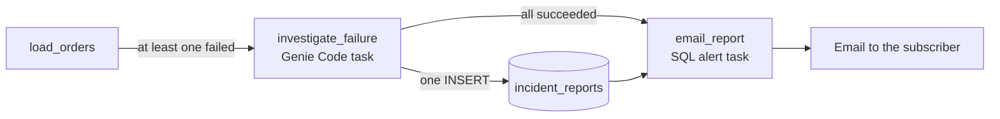

# Genie Code failure investigator

When a task in a Lakeflow Job fails, a Genie Code task in the same job investigates the failure, writes one incident report to a Unity Catalog table, and a SQL alert task emails that report. The investigator is told to read and report only. It does not fix anything.



Genie Code tasks run with auto-approval on and the docs say it cannot be turned off, so the rules in the prompt guide the agent but do not enforce anything. Permissions on the identity that runs the job are what limit it.

## What is in this folder

| Path | What it is |
| --- | --- |
| `databricks.yml` | The bundle. It deploys a one-time setup job and the SQL alert, and syncs the notebook. |
| `sql/setup.sql` | Creates the schemas, the incident table and the demo source tables. |
| `src/load_orders.py` | The demo load task. Its `scenario` parameter picks the input, and four of the values fail. |
| `prompt/investigator.md` | The prompt for the Genie Code task. |
| `tests/results.md` | What the investigator wrote for each failure scenario. |

## What the bundle does not do

The docs list Genie Code tasks as Jobs UI only. They cannot be defined in a bundle, the Jobs API or the SDKs. The alert task in this job depends on the Genie Code task, so a bundle could not own the job either. A job that a bundle owns is reset to the bundle's definition on every deploy, which I expect would remove a task added by hand. That was not tested here.

So the bundle covers everything around the job, and you create the job itself separately. You can build all three tasks in the UI, or create the job from the API and switch only the Genie Code task by hand in the UI. Both ways are described below.

## Requirements

- A workspace where the Genie Code task type is available. Check by opening a new job and searching the task list for Genie Code.
- A serverless or pro SQL warehouse. Its id is the `warehouse_id` variable.
- Permission to create a catalog schema. The files use a catalog named `release_lab`. To use your own, replace `release_lab` in `sql/setup.sql`, in the query inside `databricks.yml` and in `prompt/investigator.md`.
- Databricks CLI 1.24.0 with the direct deployment engine:

```bash
export DATABRICKS_BUNDLE_ENGINE=direct
```

## Deploy

```bash
cd databricks/genie-code-failure-investigator
databricks bundle deploy --var warehouse_id=<warehouse id> --var alert_email=<your email>
databricks bundle run setup_demo
```

The deploy creates the `setup-failure-demo` job and the `pipeline-failure-investigated` alert, and uploads the notebook to `/Workspace/Deployments/genie-code-failure-investigator/prod/files/src/load_orders`. The run of `setup_demo` creates these objects:

| Object | Purpose |
| --- | --- |
| `release_lab.ops.incident_reports` | Where the investigator writes its reports. |
| `release_lab.failure_demo.customers` | Demo source table. |
| `release_lab.failure_demo.orders_raw` | Demo source table. A column was renamed after creation, so the table history shows the change. |

`setup.sql` uses `CREATE OR REPLACE` on the two demo tables, so running it again resets them.

## Create the job in the UI

1. In Jobs and Pipelines, create a job and name it `nightly-orders-load`.
2. Add a job parameter named `scenario` with the default value `ok`.
3. Add a Notebook task named `load_orders`. Point it at the deployed notebook path above and leave the compute on serverless.
4. Add a Genie Code task named `investigate_failure`. Make it depend on `load_orders`, set Run if to **At least one failed**, and paste the contents of `prompt/investigator.md` as the prompt. Under advanced settings set a timeout and no retries.
5. Add a SQL alert task named `email_report`. Make it depend on `investigate_failure`, set Run if to **All succeeded**, pick the `pipeline-failure-investigated` alert and a warehouse, and add yourself as a subscriber.

The prompt uses `{{job.id}}` and `{{job.run_id}}` directly, so the job needs no parameters for them. If either reference does not resolve in your workspace, the task fails before it starts and the UI lists the reference as unusable under the prompt.

## Create the job through the API with one manual step

Only the investigator task has to be made in the UI. The rest of the job can be created from the API, with a placeholder notebook task where the investigator goes. Save this as `job.json`, replacing the values in angle brackets:

```json
{
  "name": "nightly-orders-load",
  "max_concurrent_runs": 1,
  "parameters": [{"name": "scenario", "default": "ok"}],
  "tasks": [
    {
      "task_key": "load_orders",
      "notebook_task": {"notebook_path": "<path to the deployed load_orders notebook>"},
      "timeout_seconds": 900
    },
    {
      "task_key": "investigate_failure",
      "depends_on": [{"task_key": "load_orders"}],
      "run_if": "AT_LEAST_ONE_FAILED",
      "notebook_task": {"notebook_path": "<path to the deployed load_orders notebook>"},
      "max_retries": 0,
      "timeout_seconds": 900
    },
    {
      "task_key": "email_report",
      "depends_on": [{"task_key": "investigate_failure"}],
      "run_if": "ALL_SUCCESS",
      "alert_task": {
        "alert_id": "<id of the pipeline-failure-investigated alert>",
        "warehouse_id": "<warehouse id>",
        "subscribers": [{"user_name": "<your email>"}]
      }
    }
  ]
}
```

```bash
databricks jobs create --json @job.json
```

Then open the job in the UI, select `investigate_failure`, change its Type from Notebook to Genie Code, paste the contents of `prompt/investigator.md` as the prompt, and save. The dependency on `load_orders` and the Run if setting stay as they were. The alert id comes from `databricks alerts-v2 list-alerts`.

After that switch, change the job's tasks only in the UI. The Jobs API does not show the Genie Code task, so a task list sent back through the API would not contain it, and what that does was not tested.

## The scenarios

Run the job with the **Run now with different parameters** option, or from the CLI, and set `scenario`:

```bash
databricks jobs run-now --json '{"job_id": <job id>, "job_parameters": {"scenario": "case_1"}}'
```

| `scenario` | What the notebook does | How it fails |
| --- | --- | --- |
| `ok` | Joins orders to customers | It succeeds, so the investigator is skipped. |
| `case_1` | Reads `orders_staging`, which does not exist | `TABLE_OR_VIEW_NOT_FOUND` |
| `case_2` | Selects the column `amount`, which was renamed to `order_amount` | `UNRESOLVED_COLUMN` |
| `case_3` | Casts `customer_id` values such as `C-1001` to an integer | `CAST_INVALID_INPUT` |
| `case_4` | Calls an internal HTTP service that does not resolve | `URLError` |

The case names say nothing about the cause on purpose. The notebook has no comments that explain the failures, so the investigator has to work from the error, the code and the table history.

## Check what the investigator did

The report is one row in the incident table:

```sql
SELECT * FROM release_lab.ops.incident_reports ORDER BY created_at DESC;
```

The prompt allows that one INSERT and nothing else, so after a run also check that nothing changed. Compare these with what they were before the run:

```sql
SHOW TABLES IN release_lab.failure_demo;
DESCRIBE HISTORY release_lab.failure_demo.orders_raw;
```

The alert emails the newest report, and only if it is less than 15 minutes old. That works because the job allows one concurrent run and the alert task starts right after the investigator inserts its row. The subject and body templates are in `databricks.yml`.

## Limits and considerations

- The task runs with auto-approval always on. The prompt tells the agent not to modify anything, but the docs call auto-approval a productivity feature, not a security boundary.
- The docs do not say which identity a Genie Code task runs as. In the lab it ran as the job owner, who can write to everything. For real use, run the job as a service principal that can read the sources and insert only into `incident_reports`. That setup was not tested here.
- Text the agent reads while investigating is untrusted. Error messages, notebook comments and table descriptions can all contain instructions, and `prompt/investigator.md` tells the agent to treat them as data.
- The Genie Code task's response and prompt are visible in the run's UI. They are not returned by the Jobs API. The task also does not appear in the API's view of the job, so changing the job's tasks through the API would remove it.
- A report can be wrong. The email says to review the suggested fix before applying it, and the confidence field is the agent's own estimate.
- The alert picks the newest report from the last 15 minutes, so it relies on the job running one run at a time. If the investigator succeeds without inserting a row, an older report from the last 15 minutes can be emailed in its place.
- An alert only emails on the first trigger unless `retrigger_seconds` is set. The bundle sets it to 1 so that every failed run sends an email.
- The alert email renders the report as an HTML table, and Gmail centers the short cells next to the long text columns, so the first screen of a long report can look empty.

## Reference

- [Genie Code task for jobs](https://learn.microsoft.com/en-us/azure/databricks/jobs/tasks/genie-code), Microsoft Learn
- [SQL alert task for jobs](https://learn.microsoft.com/en-us/azure/databricks/jobs/tasks/alert), Microsoft Learn
- [Dynamic value references](https://learn.microsoft.com/en-us/azure/databricks/jobs/dynamic-value-references), Microsoft Learn
