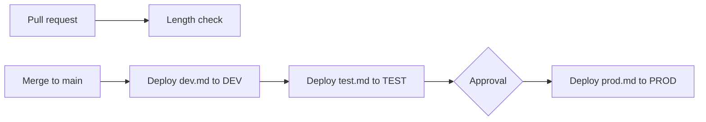

# Genie Code instructions as code

Genie Code reads workspace instructions from one file, and only workspace admins can edit it. This folder keeps a version of that file for each environment in git and deploys it with a pipeline: DEV, then TEST, then PROD after an approval. The PROD version makes Genie Code read-only, so a user with write permission still gets no write code and no execution from it. Changes to production go through the release process.

Instructions guide how Genie Code behaves. They do not replace Unity Catalog permissions, which still decide what any user or Genie Code can access.



## What is in this folder

| Path | What it is |
| --- | --- |
| `instructions/dev.md` | Permissive. Team coding conventions, and writing and running code is fine. |
| `instructions/test.md` | In between. No ad hoc writes, and read-only validation queries are allowed. |
| `instructions/prod.md` | Strict read-only. No write code and no execution. |
| `scripts/check_length.py` | Fails if an instruction file is over 20,000 characters and prints the size of each file. |
| `scripts/deploy.sh` | Uploads one file to the workspace instructions path and checks that it landed as a file. |
| `tests/test_prompts.md` | The prompts to run in PROD, with columns for the expected and the actual result. |
| `.env.example` | Placeholders for workspace hosts and service principal client IDs. |

The workflow is in `.github/workflows/genie-code-instructions.yml` at the repo root, because GitHub only reads workflows from there.

## What instructions can and cannot do

- Workspace instructions live in `/Workspace/.assistant_workspace_instructions.md`. Only workspace admins can add or edit the file.
- Genie Code ignores everything past 20,000 characters in an instructions file.
- Instructions do not apply to Quick Fix and Autocomplete.
- Genie Code also reads `AGENTS.md` and `CLAUDE.md` files. It looks for them by walking up the folder tree from the notebook or file that is open.
- The docs say Genie Code generally prioritizes workspace instructions over user instructions. They do not say how workspace instructions rank against `AGENTS.md` and `CLAUDE.md`. Row 7 in `tests/test_prompts.md` checks that case.
- The docs describe instructions as a way to guide responses, not as a way to enforce a policy. Use Unity Catalog permissions for enforcement.

## Requirements

- An access token for each workspace (DEV, TEST and PROD). The identity behind the token must be a workspace admin, because only admins can edit the instructions file. A token created for a service principal is better than a personal one, because it does not depend on one person's account. See the next section.
- A GitHub repository with three environments named `dev`, `test` and `prod`.
- Databricks CLI 1.24.0, which is the version the workflow installs. The upload uses this syntax in that version:

```bash
databricks workspace import TARGET_PATH --file FILE --format AUTO --overwrite
```

## Tokens

Create a token for a service principal that is a workspace admin, with a lifetime you choose:

```bash
databricks token-management create-obo-token <application-id> --lifetime-seconds 7776000 --comment "genie-code-instructions pipeline"
```

A personal access token from User Settings, then Developer, also works if you are a workspace admin, but it stops working when that person leaves or their account changes.

Tokens expire. When one does, the deploy step fails with an authentication error. Create a new token and replace the `DATABRICKS_TOKEN` secret for that environment.

## Set it up

1. In each workspace, create the access token (see Tokens below).
2. In the GitHub repository, go to Settings, then Environments, and create `dev`, `test` and `prod`.
3. On the `prod` environment, turn on Required reviewers and add the people who approve production changes.
4. In each environment, add two secrets for that workspace: `DATABRICKS_HOST` and `DATABRICKS_TOKEN`.
5. Optional but recommended: protect `main` so that pull requests need the length check to pass before they merge.
6. Edit the three files in `instructions/` for your teams.

## Run it

1. Change a file in `instructions/` on a branch and open a pull request. The length check runs on every pull request.
2. Merge to `main`. The pipeline deploys `dev.md` to DEV and then `test.md` to TEST.
3. The `prod` job waits for approval. A required reviewer approves it in the Actions run, and then `prod.md` is deployed to PROD.
4. Check the result. In Genie Code settings, open Workspace instructions and use View file.
5. Run the prompts in `tests/test_prompts.md` in PROD with a write-access account and fill in the last column.

### Run it by hand

You can also start the pipeline yourself, for one environment at a time:

1. In GitHub, open the Actions tab and choose the genie-code-instructions workflow.
2. Click Run workflow, pick the branch, and pick the environment: `dev`, `test` or `prod`.
3. Only the selected environment is deployed, using the matching file from `instructions/`.

DEV and TEST can run from any branch, so you can try a change before it is merged. PROD only runs from `main`. If you start a PROD run from another branch, only the length check runs. A PROD run still waits for approval from the required reviewers.

To upload from your own machine, export the host and token for one workspace and run:

```bash
export DATABRICKS_AUTH_TYPE=pat
export DATABRICKS_HOST=https://your-dev-workspace.cloud.databricks.com
export DATABRICKS_TOKEN=<token>
bash scripts/deploy.sh instructions/dev.md
```

`deploy.sh` fails if the uploaded object is not a plain workspace file.

## Roll back

Redeploy the previous version from git history:

1. Find the commit that changed the file with `git log -- instructions/prod.md`.
2. Run `git revert <commit>` on a new branch and open a pull request.
3. Merge it. The pipeline deploys the previous content to DEV and TEST, and PROD waits for approval again.

## Clean up

- Delete the file in each workspace: `databricks workspace delete /Workspace/.assistant_workspace_instructions.md`.
- Delete the `dev`, `test` and `prod` environments and their secrets in GitHub.
- Revoke the tokens you created, and delete the service principals if you no longer need them.

## Reference

- [Customize Genie Code with custom instructions](https://learn.microsoft.com/en-us/azure/databricks/genie-code/instructions), Microsoft Learn
- [Genie Code](https://learn.microsoft.com/en-us/azure/databricks/genie-code/), Microsoft Learn
