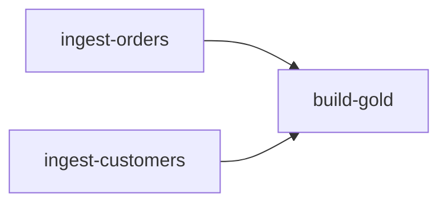

# Job completion triggers

A small pipeline that shows the job completion trigger. Two ingest jobs load raw tables, and a third job builds a summary table by itself once both of them have finished. You do not schedule the third job, you just tell it which jobs to wait for.

Article: https://medium.com/@nagarajubru/run-a-databricks-job-when-other-jobs-finish-66bd75051380

Docs: https://learn.microsoft.com/en-us/azure/databricks/jobs/job-completion-triggers



| Job | Notebook | What it does |
| --- | --- | --- |
| ingest-orders | `src/ingest_orders.py` | Writes 500 made-up orders to `bronze_orders` |
| ingest-customers | `src/ingest_customers.py` | Writes 50 made-up customers to `bronze_customers` |
| build-gold | `src/build_gold.py` | Joins both into `gold_revenue_by_region` |

The data is generated inside the notebooks, so there is nothing to download. Replace that cell with a real read when you adapt it.

## Requirements

- Databricks CLI, tested with 1.24.0. Older versions may not support the `job_completion` setting.
- A workspace with Unity Catalog and serverless jobs.
- Job Completion Triggers turned on. It is a Beta, and a workspace admin enables it on the Previews page, in the downstream workspace and in every upstream workspace.
- All participating workspaces use the same Unity Catalog metastore.
- CAN MANAGE permission on the downstream job.
- The Run as identity of the downstream job has CAN VIEW permission or higher on every job it monitors.
- A catalog you can create schemas in.

## How it works

- One trigger monitors 1 to 10 upstream jobs and applies one result filter to all of them.
- With one upstream job, each matching completion starts a downstream run.
- With several upstream jobs, a downstream run starts only after every monitored job has a new matching completion. If a job completes more than once first, its latest matching completion counts.
- Completions that happened before you created the trigger do not start runs.
- If you change the monitored jobs or the result filter, the progress resets.
- If the downstream job is at its maximum number of concurrent runs, the completions are kept until a slot opens.

## Set it up

From the repo root, copy the env file and fill it in:

```bash
cp .env.example .env
```

Values this feature uses:

| Variable | What to put |
| --- | --- |
| `DATABRICKS_HOST` | Your workspace URL |
| `DATABRICKS_TOKEN` | A personal access token |
| `BUNDLE_VAR_workspace_id` | The number after `?o=` in your workspace URL |
| `BUNDLE_VAR_catalog` | Catalog for the tables |
| `BUNDLE_VAR_schema` | Schema for the tables, created if it is missing |
| `DATABRICKS_BUNDLE_ENGINE` | `direct` to skip Terraform |

Then load it and deploy:

```bash
set -a; source .env; set +a
cd databricks/job-completion-triggers
databricks bundle validate
databricks bundle deploy
```

## Where it deploys

The `prod` target in `databricks.yml` puts the files in `/Workspace/Deployments/job-completion-triggers/prod` instead of a user folder, and gives the `admins` group manage rights and everyone else view rights. Create `/Workspace/Deployments` once and keep it restricted. If you want a different folder or group, change `root_path` and the `owner_group` variable.

The jobs run as whoever deploys them. If you have a service principal, add a `run_as` block to the target.

Avoid `/Workspace/Shared` for the deployment folder. The Databricks CLI warns that every workspace user can write there.

If you add a target in development mode, it does not accept the `trigger_pause_status` preset set to `UNPAUSED`. Set `pause_status` on the job trigger itself, or resume the trigger after you deploy.

## Try it

```bash
databricks bundle run ingest_orders
databricks bundle run ingest_customers
```

When both finish, `build-gold` starts on its own. Open it and look at **Schedules & Triggers** to see which upstream jobs it is tracking.

To see what happens on a failure, run one of the ingest jobs with a parameter:

```bash
databricks bundle run ingest_orders --params fail=true
```

The run fails and `build-gold` stays idle, because the trigger only fires on `SUCCESS`. Change `if_status` in `databricks.yml` to `FAILED` or `DONE` to react to other outcomes.

## Upstream run result

The trigger has one setting that decides which outcomes count, called **Upstream run result** in the UI and `if_status` in the bundle. It applies to all the jobs the trigger watches.

| In the UI | In the bundle | The downstream job starts when |
| --- | --- | --- |
| Succeeded (default) | `SUCCESS` | The run passed, including a run that passed with some failures |
| Failed | `FAILED` | The run ended in any failure |
| Completed with any result | `DONE` | The run finished, whatever the outcome |

This repo uses `SUCCESS`, which is why a failed ingest does not start `build-gold`. Use `FAILED` for something like an alert or cleanup job, and `DONE` when you only care that the upstream work is over.

## Setting it up in the UI instead

The bundle writes the same trigger you can build by hand:

1. Open the job that should run last and go to **Schedules & Triggers**, then **Add trigger**.
2. Set **Trigger type** to **Upstream job completion**.
3. Under **Upstream jobs**, pick the workspace and the job, and use **Add upstream job** for each extra one.
4. Pick the **Upstream run result**.
5. Use **Test trigger** to check it, then **Save**.

After saving, the job shows how many jobs it watches, which result it waits for, and a list of the jobs it runs after.

## Upstream run details

The trigger passes details about the runs that started the downstream job through the `upstream_completions` job parameter, set to `{{job.trigger.job_completion.completed_jobs}}`. The value is a JSON array with one entry per monitored job: workspace ID, job ID, run ID, termination code and completion time. A manual run resolves it to an empty array. `build_gold.py` prints the entries.

## Limits and considerations

- A trigger monitors up to 10 jobs.
- A workspace can have up to 1,000 active job completion triggers. They count toward the workspace limit of 12,000 active triggers.
- All jobs in a trigger share one result filter.
- Completions are not matched by business date or data batch.
- This example uses the single `trigger` setting. Several triggers on one job need the Multiple Triggers Beta, which uses a `triggers` list. See [Add multiple triggers to a job](https://learn.microsoft.com/en-us/azure/databricks/jobs/triggers#multiple-triggers).
- On a workspace that uses Default Storage, create the catalog in the UI. The CLI and API need an explicit storage location.

## Clean up

```bash
databricks bundle destroy
```

That removes the jobs. The schema and tables stay, so drop them yourself if you want them gone:

```sql
DROP SCHEMA <catalog>.<schema> CASCADE;
```

## Reference

- [Job completion triggers](https://learn.microsoft.com/en-us/azure/databricks/jobs/job-completion-triggers), Microsoft Learn
- [Automate jobs with schedules and triggers](https://learn.microsoft.com/en-us/azure/databricks/jobs/triggers), Microsoft Learn
