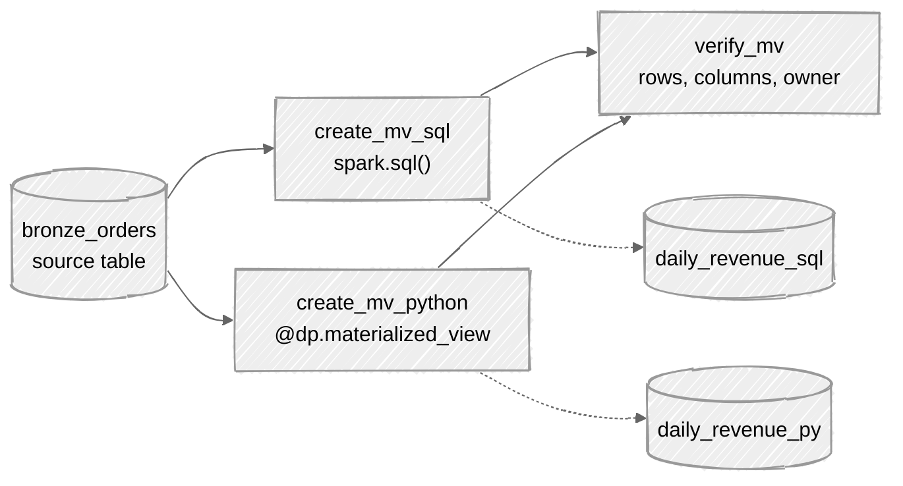

# Create a materialized view from a notebook on serverless compute

This folder creates a materialized view from a notebook on serverless general compute, two ways: with SQL through `spark.sql()`, and with the Python pipelines decorator `@dp.materialized_view`. Both read the daily revenue and the number of orders from `release_lab.jct_demo.bronze_orders`, which the `job-completion-triggers` folder creates. A GitHub Actions workflow deploys a bundle with one job that creates both views and then checks them.



The results of the tests, with the exact errors, are in `tests/results.md`.

## What is in this folder

| Path | What it is |
| --- | --- |
| `databricks.yml` | The bundle. One job, `create_materialized_views`, with three serverless notebook tasks. |
| `notebooks/create_mv_sql.py` | Creates `daily_revenue_sql` with `spark.sql()`. |
| `notebooks/create_mv_python.py` | Creates `daily_revenue_py` with `@dp.materialized_view`. |
| `notebooks/verify_mv.py` | Prints the row count, the columns and the owner of both views. Fails if either has no rows. |
| `sql/setup.sql` | Creates the schema and confirms the source table exists. |
| `tests/results.md` | What happened in each test. |
| `tests/screenshots/` | Screenshots of the workflow run, the job run and the views. |
| `.env.example` | Placeholders for the workspace and the warehouse. |

The workflow is `.github/workflows/materialized-view.yml` at the root of the repository.

## Requirements

- A workspace with Unity Catalog and serverless compute enabled. The tests ran on Databricks Free Edition.
- Databricks Runtime 18.1 or above for `spark.sql()` to create the view. Interactive notebooks meet this automatically, but a job pinned to an older version does not.
- For the Python version, a serverless environment version that can import `pyspark.pipelines`. The job pins version 6, which all the tests ran on. Version 5, the documented minimum, also worked in a one-time test.
- The `CREATE MATERIALIZED VIEW` privilege on the target schema, and `USE CATALOG` and `USE SCHEMA` on it.
- `SELECT` on the source table `release_lab.jct_demo.bronze_orders`.
- A serverless or pro SQL warehouse, used only to run `sql/setup.sql` by hand.
- Databricks CLI 1.24.0 with the direct deployment engine:

```bash
export DATABRICKS_BUNDLE_ENGINE=direct
```

To use your own catalog or source table, change the variables at the top of `databricks.yml` and the names in `sql/setup.sql`.

## Run it by hand

```bash
cp .env.example .env     # fill in your own values
set -a; source .env; set +a
```

Run `sql/setup.sql` once in the SQL editor. If the source table is missing, the last statement fails and says so. Then deploy and run the job:

```bash
cd databricks/materialized-view-serverless-notebook
databricks bundle deploy -t prod
databricks bundle run create_materialized_views -t prod
```

The job runs `create_mv_sql` and `create_mv_python` side by side, then `verify_mv`. Running the job again with nothing changed reruns the same statements, see `tests/results.md` for what that does to the views.

To check a view yourself:

```python
import json
j = json.loads(spark.sql("DESCRIBE TABLE EXTENDED release_lab.mvst_demo.daily_revenue_sql AS JSON").collect()[0][0])
print(j["owner"], j["refresh_information"]["last_refresh_type"])
```

## Deploy with GitHub Actions

The workflow follows the same conventions as the `genie-code-instructions` workflow.

1. In the repository settings, create the environments `dev`, `test` and `prod`.
2. In each environment, add the secrets `DATABRICKS_HOST` and `DATABRICKS_TOKEN` for that workspace. Use a token of the user or service principal that should own the views.
3. Open the Actions tab, choose the `materialized-view` workflow, click Run workflow and pick the environment. It also runs by itself on a push to `main` that changes this folder, and that run deploys to `prod`.
4. The steps are: check out, install CLI 1.24.0, `bundle validate`, `bundle deploy`, `bundle run create_materialized_views`. The workflow fails if the job run fails.

PROD only runs from `main`. DEV and TEST can run from any branch. A concurrency group makes sure two deployments never run at the same time.

**The identity the workflow signs in as becomes the owner of the views, and only the owner can refresh them.** Refreshes must happen through this job, or through another serverless notebook task run by the same identity.

## Limitations

- Only the owner can refresh the views.
- A view can only be refreshed with the compute type it was created with. Views created on serverless general compute cannot be created or refreshed from a SQL warehouse, including a SQL task in a job.
- There is no asynchronous refresh for these views.
- With the Python decorator, expectations, additional flows, CDC flows and sinks are not supported, and a `REFRESH` statement does not work on the view.
- Cost attribution is not available for this compute.
- `DESCRIBE TABLE EXTENDED ... AS JSON` shows the owner, the pipeline id and the refresh status, but it has no field for the compute type. Catalog Explorer shows it on the Details tab as Creation compute type.

## Cleanup

```sql
DROP MATERIALIZED VIEW IF EXISTS release_lab.mvst_demo.daily_revenue_sql;
DROP MATERIALIZED VIEW IF EXISTS release_lab.mvst_demo.daily_revenue_py;
```

Each view also leaves an `event_log_...` table in the schema after it is dropped. List them with `SHOW TABLES IN release_lab.mvst_demo` and drop the ones you no longer need. To remove the job:

```bash
databricks bundle destroy -t prod
```

Then delete the GitHub environments and their secrets, and revoke the token if you no longer need it.

## Reference

- [November 2026 release notes](https://learn.microsoft.com/en-us/azure/databricks/release-notes/product/2026/november), Databricks documentation
- [Requirements for standalone pipelines](https://learn.microsoft.com/en-us/azure/databricks/ldp/dbsql/compute), Microsoft Learn
- [Use Python with standalone pipelines](https://learn.microsoft.com/en-us/azure/databricks/sql/mv-st/using-python), Microsoft Learn
- [Use standalone materialized views](https://learn.microsoft.com/en-us/azure/databricks/sql/mv-st/materialized), Microsoft Learn
