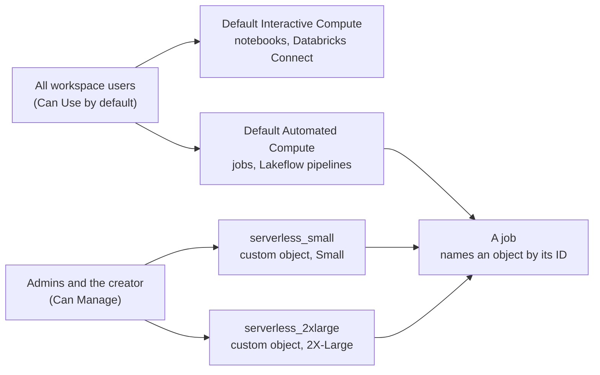
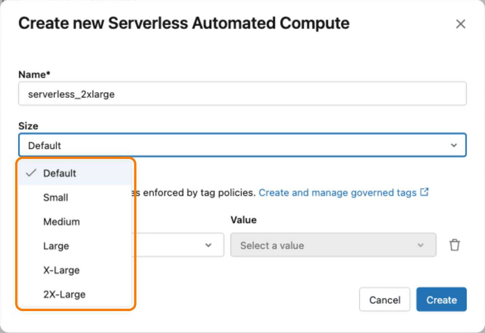
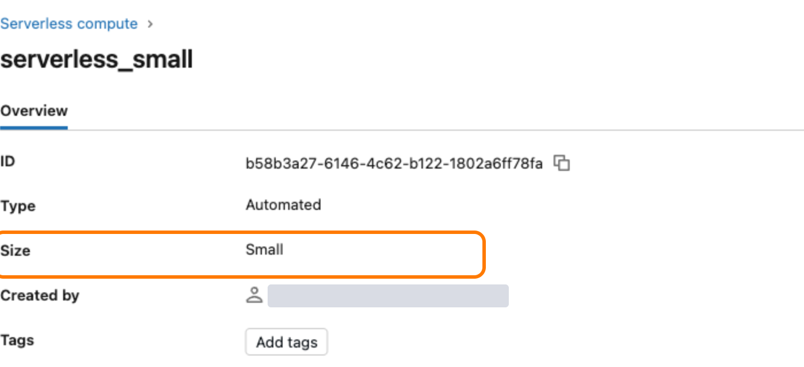
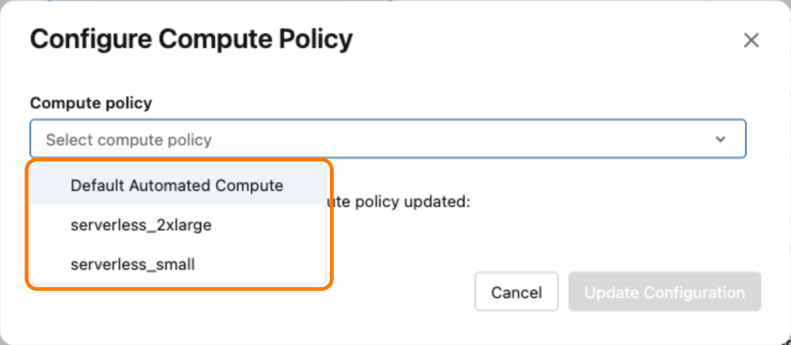
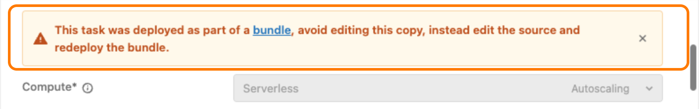

# Databricks serverless compute objects

Serverless compute used to be something you simply used. Now a workspace has serverless compute objects that you can see on the Serverless tab of the Compute page, and you can create your own with a name and a size, point jobs at them, and control who can use them. This folder creates two custom objects, `serverless_small` and `serverless_2xlarge`, points the same job at each of them, and compares the runs, on a Databricks Free Edition workspace.



## What objects there are

Every workspace has two default objects that cannot be deleted. Default Interactive Compute governs notebooks and Databricks Connect, and Default Automated Compute governs jobs and Lakeflow pipelines. A job that names no object runs on Default Automated Compute.

You can add your own automated objects. Each has a name, a size, an ID and optional governed tags.


## Requirements

- A workspace with the Serverless tab on the Compute page. The docs say creating an object needs workspace admin or the unrestricted cluster creation entitlement.
- Databricks CLI 1.24.0 with the direct deployment engine:

```bash
export DATABRICKS_BUNDLE_ENGINE=direct
```

## Create an object

1. Open Compute, then the Serverless tab, and choose Create serverless compute.
2. Give it a name and pick a size: Default, Small, Medium, Large, X-Large or 2X-Large. Tags are optional, and the tag keys are governed tags.
3. Create it. Open it to see its ID, type, size and creator. Edit changes the name and size, and the Actions menu on the list has Edit permissions, Copy compute ID and Delete.





Copy the ID. A job refers to an object by its ID, not by its name.

## Point a job at an object

**With a bundle.** Put the object's ID in a job cluster with `serverless_compute.policy_id`, and give the task that job cluster's key. This bundle takes the ID as a variable:

```yaml
job_clusters:
  - job_cluster_key: serverless_object
    serverless_compute:
      policy_id: ${var.compute_id}
tasks:
  - task_key: workload
    job_cluster_key: serverless_object
    notebook_task:
      notebook_path: ./src/workload.py
```

```bash
cd databricks/serverless-compute-objects
databricks bundle deploy --var compute_id=<object id>
databricks jobs get <job id>
```

`jobs get` should show the ID under `job_clusters`. The ID of Default Automated Compute works there too.

**In the Jobs UI.** Open the job, then Tasks, select the task, and click the pencil next to Compute, which is labelled Configure compute policy. Choose the object, click Update Configuration, and then click Save task. The dialog only stages the change, so the job does not change until Save task. The Jobs API then shows the same `serverless_compute.policy_id` as the bundle.



A job that a bundle deployed cannot be edited this way. Its task form is read only, with a banner telling you to edit the source and redeploy. Use the UI on jobs you created by hand.



## Who can use an object

| Object | Permissions |
| --- | --- |
| Default Automated Compute | `users` Can Use, `admins` Can Manage (inherited) |
| A new custom object | The creator Can Manage and `admins` Can Manage (inherited). The `users` group has no access. |

So a new object is private until you grant access. Read and change the permissions with:

```bash
databricks permissions get serverless-compute <object id>
databricks permissions update serverless-compute <object id> \
  --json '{"access_control_list":[{"group_name":"<group>","permission_level":"CAN_USE"}]}'
```

The update call adds an entry and keeps the others. Setting the list with `permissions set` replaces it, so read the permissions first and save them.

## The size

The size belongs to the rate limit feature, which caps how far a job's Spark executors can autoscale. In this test it changed nothing: the same workload took the same time on `serverless_small`, `serverless_2xlarge` and the default compute. The numbers are in `tests/results.md`. The workspace has no Previews page and no rate limit setting, so the cap was most likely not enforced, but that was not confirmed.

## Run the comparison

```bash
databricks bundle deploy --var compute_id=<serverless_small id>
databricks bundle run serverless_objects_demo
databricks bundle deploy --var compute_id=<serverless_2xlarge id>
databricks bundle run serverless_objects_demo
```

The job parameters `rows` and `partitions` scale the workload. Start with the defaults, because Free Edition limits how much compute you can use. Run each size more than once: the first run on a new object was slower than the rest.

## Cleanup

Delete the job and its files with `databricks bundle destroy`, and delete the objects you created from the Actions menu on the Serverless tab. The default objects cannot be deleted.

## Reference

- [Manage serverless compute](https://learn.microsoft.com/en-us/azure/databricks/compute/serverless/manage-serverless-compute), Microsoft Learn
