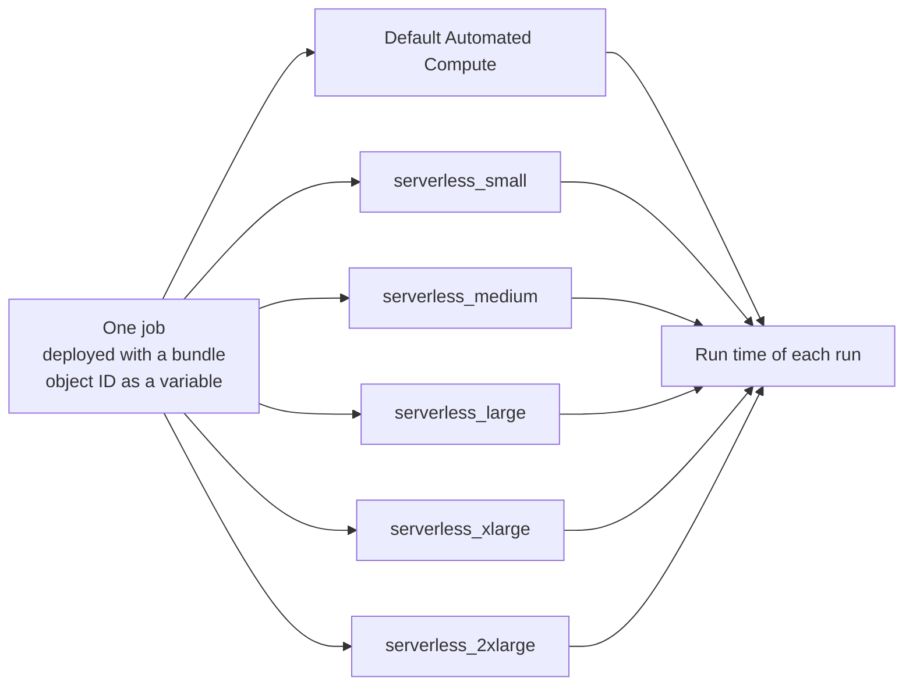
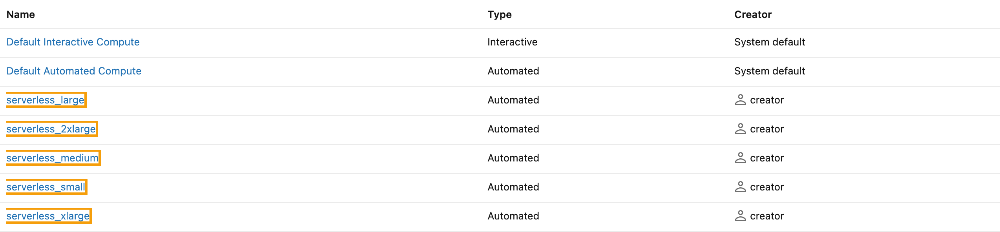

# Databricks serverless compute objects

Serverless compute is no longer only something you use. On the Serverless tab of the Compute page you can create your own serverless compute objects, each with a name and a size, and point a job at one. This folder creates an object for every size, runs the same job on each of them with a bundle, and compares the run times.



## The objects

Every workspace has two default objects that cannot be deleted: Default Interactive Compute for notebooks and Databricks Connect, and Default Automated Compute for jobs and Lakeflow pipelines. A job that names no object runs on Default Automated Compute. You can add your own automated objects, each with a name, a size, an ID and optional governed tags.



## Requirements

- A workspace with the Serverless tab on the Compute page. The docs say creating an object needs workspace admin or the unrestricted cluster creation entitlement.
- Databricks CLI 1.24.0 with the direct deployment engine:

```bash
export DATABRICKS_BUNDLE_ENGINE=direct
```

## Create an object

1. Open Compute, then the Serverless tab, and choose Create serverless compute.
2. Give it a name and a size: Default, Small, Medium, Large, X-Large or 2X-Large. Tags are optional.
3. Create it, open it and copy its ID.


This test uses five objects, one per size: `serverless_small`, `serverless_medium`, `serverless_large`, `serverless_xlarge` and `serverless_2xlarge`.

## Point a job at an object

Put the object's ID in a job cluster with `serverless_compute.policy_id` and give the task that job cluster's key. This bundle takes the ID as a variable:

```yaml
job_clusters:
  - job_cluster_key: serverless_object
    serverless_compute:
      policy_id: ${var.compute_id}
tasks:
  - task_key: workload
    job_cluster_key: serverless_object
    notebook_task:
      notebook_path: ./src/workload.py
```

```bash
cd databricks/serverless-compute-objects
databricks bundle deploy --var compute_id=<object id>
databricks bundle run serverless_objects_demo
databricks jobs get <job id>
```

`jobs get` shows the ID under `job_clusters`. The ID of Default Automated Compute works there too.

## Who can use an object

| Object | Permissions |
| --- | --- |
| Default Automated Compute | `users` Can Use, `admins` Can Manage (inherited) |
| A new custom object | The creator Can Manage and `admins` Can Manage (inherited). The `users` group has no access. |

A new object is private until you grant access:

```bash
databricks permissions get serverless-compute <object id>
databricks permissions update serverless-compute <object id> \
  --json '{"access_control_list":[{"group_name":"<group>","permission_level":"CAN_USE"}]}'
```

The update call adds an entry and keeps the others. `permissions set` replaces the whole list, so read the permissions first.

## Result

The same job, 3 billion rows in 12,000 partitions, ran twice on every size. The run time was 84 to 86 seconds on all five objects and on the default compute, apart from the first run on the default compute, which took 100 seconds. The size made no difference to the run time. The numbers are in `tests/results.md`.

The size belongs to the rate limit feature, which caps how far a job's Spark executors can autoscale. A cap only matters when a workload would scale past it.

## Cleanup

Delete the job with `databricks bundle destroy`, and delete the objects from the Actions menu on the Serverless tab. The default objects cannot be deleted.

## Reference

- [Manage serverless compute](https://learn.microsoft.com/en-us/azure/databricks/compute/serverless/manage-serverless-compute), Microsoft Learn
