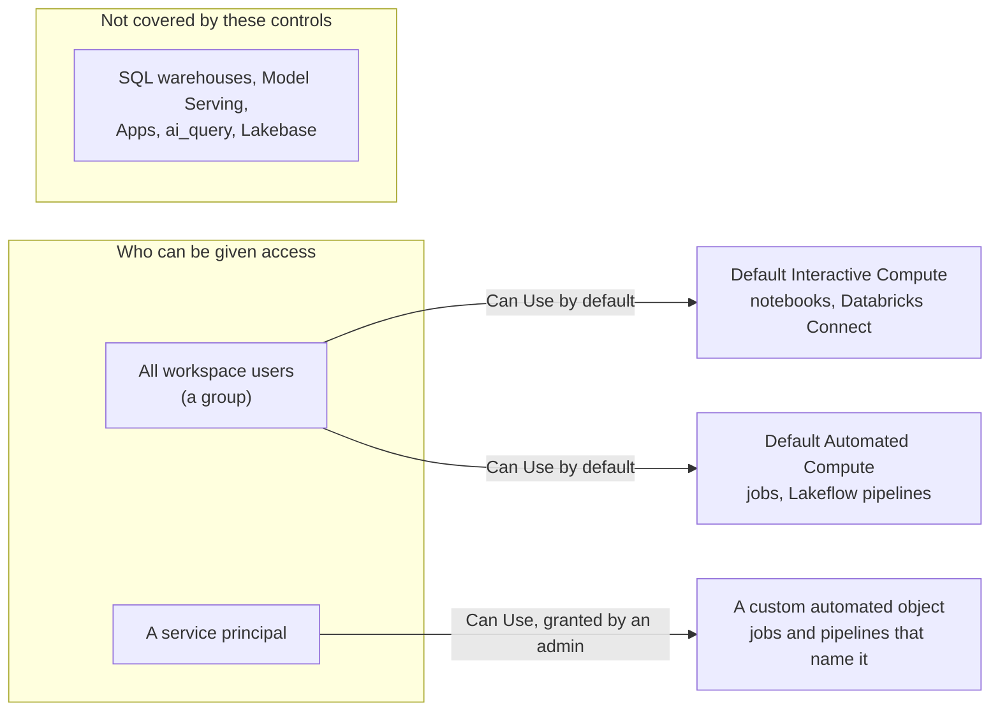

# Serverless compute access control

Every workspace has two built-in serverless compute objects. Default Interactive Compute governs notebooks and Databricks Connect, and Default Automated Compute governs jobs and Lakeflow pipelines. By default all workspace users have Can Use on both, and a workspace admin can remove the group to restrict who can start serverless workloads. This folder tests that on a Free Edition workspace, using a service principal as the user who loses access.



## What the test found

- Removing the `users` group from Default Automated Compute works, but it is not instant. A probe job succeeded 29 seconds after the change and failed 3 minutes 47 seconds after it.
- A job that names no compute object fails when it runs, in about a second, with `Run-as user '<application-id>' is not entitled to use serverless compute.` A one-time run submitted by the same service principal was accepted by the API and then failed the same way.
- A job that names the restricted default object is rejected earlier, when it is saved, with HTTP 403.
- Databricks SQL is not covered. The same service principal could still query the table through a SQL warehouse while its jobs could not start.
- A new custom compute object starts private. Only the creator and the admins can use it, and a grant to a service principal took effect immediately.

The numbers, the exact errors and the screenshots are in `tests/results.md` and `tests/screenshots/`.

## What is in this folder

| Path | What it is |
| --- | --- |
| `databricks.yml` | The bundle. One job, `sp_serverless_probe`, that runs as a service principal. |
| `src/probe.py` | The notebook. It returns the current user and the row count of a demo table. |
| `diagrams/access-control.mmd` | The diagram above, in the hand drawn style. |
| `tests/permissions_before.json` | The permissions of both default objects before any change. |
| `tests/permissions_during_restriction.json` | Default Automated Compute while the group was removed. |
| `tests/results.md` | What happened at each step. |
| `tests/screenshots/` | The permissions dialog before and after, the failed run, the successful run on a custom object, and the SQL statement that still worked. |

## Requirements

- A workspace admin. Changing the permissions of the default objects needs Can Manage on them, which admins have.
- A service principal to test with, with the Workspace access and Databricks SQL access entitlements, and read access to the table the probe reads. The probe reads `release_lab.jct_demo.bronze_orders` from the other features in this repository. Change the table name in `src/probe.py` to use your own.
- The Service Principal User role on that service principal for the user who deploys the job. A service principal created through the API gave its creator the Manager role but not the User role. The Permissions API does not accept service principals, so this test granted the User role with the access control rule sets API.
- Databricks CLI 1.24.0 with the direct deployment engine:

```bash
export DATABRICKS_BUNDLE_ENGINE=direct
```

## Run the test

1. Read and save the current permissions of both default objects. The IDs are on the Serverless tab of Compute, from the kebab menu with Copy compute ID.

```bash
databricks permissions get serverless-compute <default automated id> -o json
databricks permissions get serverless-compute <default interactive id> -o json
```

2. Deploy the probe job and run it once as the baseline:

```bash
cd databricks/serverless-compute/access-control
databricks bundle deploy --var sp_application_id=<service principal application id>
databricks bundle run sp_serverless_probe
```

3. Remove the `users` group from Default Automated Compute, keeping `admins`:

```bash
databricks permissions set serverless-compute <default automated id> \
  --json '{"access_control_list":[{"group_name":"admins","permission_level":"CAN_MANAGE"}]}'
```

4. Wait a few minutes, then run the probe again. It should fail with the not entitled error. Run a SQL statement as the service principal on a warehouse and see that it still works.

5. To give one identity its own compute, create a custom automated object in the Serverless tab, add the service principal with Can Use, and deploy the job against it:

```bash
databricks permissions update serverless-compute <custom object id> \
  --json '{"access_control_list":[{"service_principal_name":"<application id>","permission_level":"CAN_USE"}]}'
databricks bundle deploy --var sp_application_id=<application id> --var compute_id=<custom object id>
```

## Restore it

**Do this before you finish.** While the group is removed, every non-admin user who runs a job on Default Automated Compute gets the error above.

Put back only the `users` group. Do not send `admins` again: setting the permissions with `admins` in the list creates a second, direct `admins` entry next to the inherited one, and the object no longer matches its original state.

```bash
databricks permissions set serverless-compute <default automated id> \
  --json '{"access_control_list":[{"group_name":"users","permission_level":"CAN_USE"}]}'
databricks permissions get serverless-compute <default automated id> -o json
```

Compare the result with `tests/permissions_before.json`. They should be identical. Then deploy the job against the default object again and run it to confirm the service principal works.

## Limits and considerations

- The docs say access checks might fail open during a service disruption, so this is not a spend cap.
- Background system jobs are exempt, and so are Databricks SQL, `ai_query()` batch inference, Model Serving, Apps and Lakebase.
- A new custom object does not give the `users` group access. Grant each group or identity that should use it.
- The restriction needs a few minutes to apply, so a test that runs right after the change can pass for the wrong reason.

## Not tested

- Default Interactive Compute and Databricks Connect. Serverless Databricks Connect needs a supported Python version (3.12 for current releases), which the test machine did not have.
- The two audit queries from the docs, which read `system.billing.usage` by user and by compute object.
- Removing a single user instead of a group, and Lakeflow pipelines.

## Cleanup

Restore the default objects as described above, delete any custom compute object you created from the Serverless tab, and remove the job and its deployed files with `databricks bundle destroy`.

## Reference

- [Manage serverless compute](https://learn.microsoft.com/en-us/azure/databricks/compute/serverless/manage-serverless-compute), Microsoft Learn
