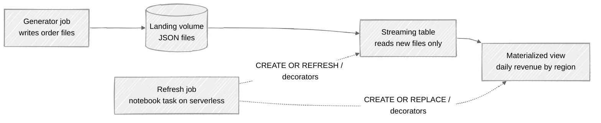

# Standalone streaming tables and materialized views on serverless

This folder creates and refreshes a streaming table and a materialized view from a notebook on serverless compute, in two versions: one defined with SQL through `spark.sql()`, and one with the Python pipelines decorators. A generator writes batches of order files into a volume, the streaming table reads the new files, and the materialized view keeps daily revenue by region.



The results of testing both versions, with timings and exact error messages, are in `tests/results.md`.

## What is in this folder

| Path | What it is |
| --- | --- |
| `databricks.yml` | The bundle. It deploys the notebooks and the jobs that run them. |
| `sql/setup.sql` | Creates the schema and the landing volume. |
| `sql/refresh_mv_sql.sql` | A `REFRESH` statement, used to test refreshing from a warehouse. |
| `src/generate_orders.py` | Writes one batch of order files. Parameters: `batch` and `rows`. |
| `src/version_a_sql.py` | Version A. Defines the objects with SQL. |
| `src/version_b_python.py` | Version B. Defines the objects with the Python decorators. |
| `src/refresh_sql.py` | Version A. Refreshes both objects with `REFRESH` statements. |
| `src/measure.py` | Reports row counts, the refresh type and the refresh history of one version. |
| `src/check_environment.py` | Reports the runtime and whether `pyspark.pipelines` can be imported. |
| `diagrams/` | Mermaid sources for the flow and the refresh behavior. |
| `tests/results.md` | What happened in each test. |
| `tests/screenshots/` | Screenshots of the notebooks, the catalog, the refresh details and an error. |
| `.env.example` | Placeholders for the workspace and the warehouse. |

## Requirements

- A workspace with Unity Catalog and serverless compute. The tests ran on Databricks Free Edition.
- A serverless or pro SQL warehouse, used for the setup SQL.
- Databricks CLI 1.24.0 with the direct deployment engine:

```bash
export DATABRICKS_BUNDLE_ENGINE=direct
```

- Permission to create a schema and a volume in the catalog. The files use a catalog named `release_lab`. To use your own, replace `release_lab` in `sql/`, in the notebook widget defaults in `src/`, and in `sql/refresh_mv_sql.sql`.

## Setup

```bash
cp .env.example .env     # fill in your own values
set -a; source .env; set +a
export BUNDLE_VAR_warehouse_id=$WAREHOUSE_ID
```

Run `sql/setup.sql` once in the SQL editor to create the schema and the volume. Then deploy the jobs:

```bash
cd databricks/standalone-pipelines-serverless
databricks bundle deploy
```

## Run it

Each job is started from the Jobs page or with the CLI. Add the first batch of files, then run a version.

```bash
databricks bundle run generate_batch --params batch=1,rows=200
databricks bundle run refresh_sql        # Version A: creates the objects, and refreshes them on later runs
databricks bundle run refresh_python     # Version B: the same with the Python decorators
```

To add another batch, run the generator with the next number, then refresh:

```bash
databricks bundle run generate_batch --params batch=2,rows=200
databricks bundle run refresh_sql_statements   # Version A with REFRESH statements
databricks bundle run refresh_python           # Version B: rerun the notebook
```

Version B has no refresh statement. The decorators refresh the objects when the notebook runs again.

## Check what happened

Row counts, the refresh type and the refresh history for one version:

```bash
databricks bundle run measure --params version=sql
```

Or run the pieces yourself in a notebook:

```python
# The refresh type: INCREMENTAL, RECOMPUTED or NO OPERATION
spark.sql("DESCRIBE TABLE EXTENDED release_lab.mvst_demo.daily_revenue_sql AS JSON").show(truncate=False)

# The technique chosen for each refresh of the materialized view
spark.sql("""
    SELECT timestamp, message
    FROM event_log(TABLE(release_lab.mvst_demo.daily_revenue_sql))
    WHERE event_type = 'planning_information'
    ORDER BY timestamp DESC
""").show(truncate=False)
```

The event log can be queried only by the owner of the object, and `DESCRIBE DETAIL` does not work on a materialized view.

## Things that will trip you up

- **The environment decides whether Version B runs.** The Python decorators need a newer serverless environment than a one-time `jobs submit` run uses by default. A saved job from this bundle ran on `client.6.5` and worked. Run `check_environment` to see what you get. A one-time run needs `environment_version` 5 or 6, and on 5 the Auto Loader read needs `cloudFiles.schemaLocation`.
- **Refresh from a notebook task, not a SQL task.** Objects created in a serverless notebook cannot be refreshed from a SQL warehouse. The `mvst-refresh-from-warehouse` job exists to show that error.
- **`REFRESH` works only on objects created with SQL.** Objects created with the decorators are refreshed by running the notebook again.
- **Extra tables appear in the schema.** Each object adds a `__materialization_...` table and an `event_log_...` table. The event log table stays after the object is dropped.
- **Rerunning is cheap when nothing changed.** The materialized view is planned as a no-operation and keeps its id.
- **Changing the materialized view definition recomputes it in full.** Dropping the streaming table makes it read every file in the volume again.

## Cleanup

Drop the objects, then the leftovers. List the `event_log_` tables first and drop only the ones in this schema.

```sql
DROP MATERIALIZED VIEW IF EXISTS release_lab.mvst_demo.daily_revenue_sql;
DROP MATERIALIZED VIEW IF EXISTS release_lab.mvst_demo.daily_revenue_py;
DROP TABLE IF EXISTS release_lab.mvst_demo.orders_st_sql;
DROP TABLE IF EXISTS release_lab.mvst_demo.orders_st_py;

SHOW TABLES IN release_lab.mvst_demo;   -- then DROP TABLE each event_log_... table
DROP VOLUME IF EXISTS release_lab.mvst_demo.landing;
DROP SCHEMA IF EXISTS release_lab.mvst_demo CASCADE;
```

```bash
databricks bundle destroy
```

## Reference

- [Requirements for standalone pipelines](https://learn.microsoft.com/en-us/azure/databricks/ldp/dbsql/compute), Microsoft Learn
- [Use Python with standalone pipelines](https://learn.microsoft.com/en-us/azure/databricks/sql/mv-st/using-python), Microsoft Learn
- [Use standalone streaming tables](https://learn.microsoft.com/en-us/azure/databricks/sql/mv-st/streaming), Microsoft Learn
- [Use standalone materialized views](https://learn.microsoft.com/en-us/azure/databricks/sql/mv-st/materialized), Microsoft Learn
- [Incremental refresh for materialized views](https://learn.microsoft.com/en-us/azure/databricks/ldp/incremental-refresh), Microsoft Learn
